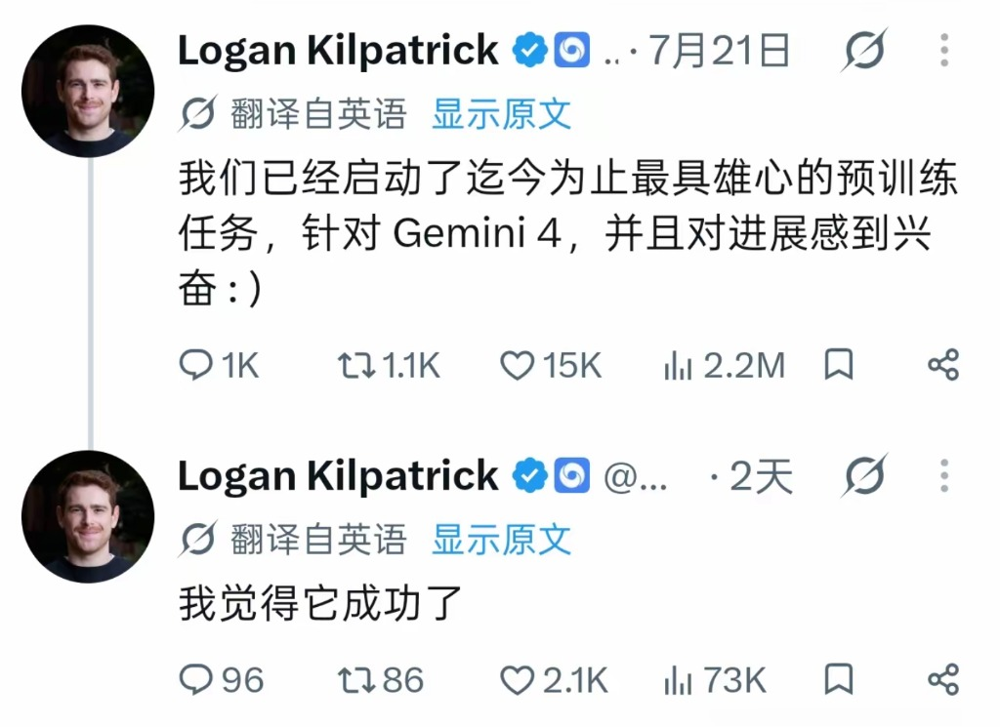

今年下半年，AI 圈最富戏剧性的戏码，莫过于 Google Gemini 的一场绝地反转。

6 月份，备受瞩目的 Gemini 3.5 Pro 表现未达预期，一时间，“跌落神坛”“彻底掉队”的唱衰声不绝于耳。7 月 21 日，Gemini 产品负责人 Logan Kilpatrick 在社交平台上发文，坦然直面当下的不足，并宣布团队已正式启动迄今最具雄心的 Gemini 4 预训练任务。面对评论区里的公开调侃与质疑，Logan 没有陷入无意义的口水战，只是淡然回应：“谢了，这下团队更有动力了。”

此后数月，Google 顶着外界的舆论压力保持了极致的克制，甚至果断放弃了对 3.5 Pro 的反复修补与执念。正当几乎所有人都以为他们已经默认掉队时，11 月底，Gemini 4 带着一骑绝尘的成绩单横空出世，在推理、科学基准等多项核心榜单上强势登顶。

发布之际，Logan 重新翻出自己四个月前那条曾饱受群嘲的动态，只云淡风轻地跟评了一句：“我觉得它成功了。”

随后，他又带着几分释然与自嘲补发了一条推文：“现在，我们终于可以发布 3.5 Pro 了（now we can finally release 3.5 Pro）”——用一句轻松的调侃，彻底翻过了那段略显狼狈的篇章。

这场漂亮的翻身仗之所以令人触动，不仅在于技术层面的逆袭，更在于它揭示了一种在复杂环境中极为稀缺的决策智慧。

在现实生活与工作中，我们往往习惯于要求自己保持一条线性的、不间断的上升轨迹。一旦在某个阶段遭遇滑铁卢——无论是选错了一条技术或职业路径、搞砸了某个核心项目，还是单纯陷入了长期的低效与迷茫——我们的本能反应往往是不甘与抗拒。为了维护表面的体面，很多人会选择在原地反复缝补，试图用加倍的消耗去挽回一个注定平庸的结局，最终却在无休止的自我内耗中，错失了重构与转型的最佳窗口。

**但真正的成熟，恰恰在于具备阶段性“止损”的魄力。**

如果一个版本从底层逻辑上就已经受限，继续打补丁的边际效益终究会趋近于零。与其把宝贵的心力耗费在证明“当初没有错”上，不如坦然承认当下的局限，允许自己经历一段不那么光彩的“3.5 时期”。把已经沉没的成本果断封存，不对过往的失误做无谓的辩解，而是将全部筹码与注意力重新聚焦于下一代系统的蓄力与重构。

任何系统的演进都不可能一蹴而就，个体的成长同样如此。正视阶段性的平庸与受挫，拥有随时推倒重来的底气，我们才能在漫长的周期里，真正迎来属于自己的“4.0 时刻”。
